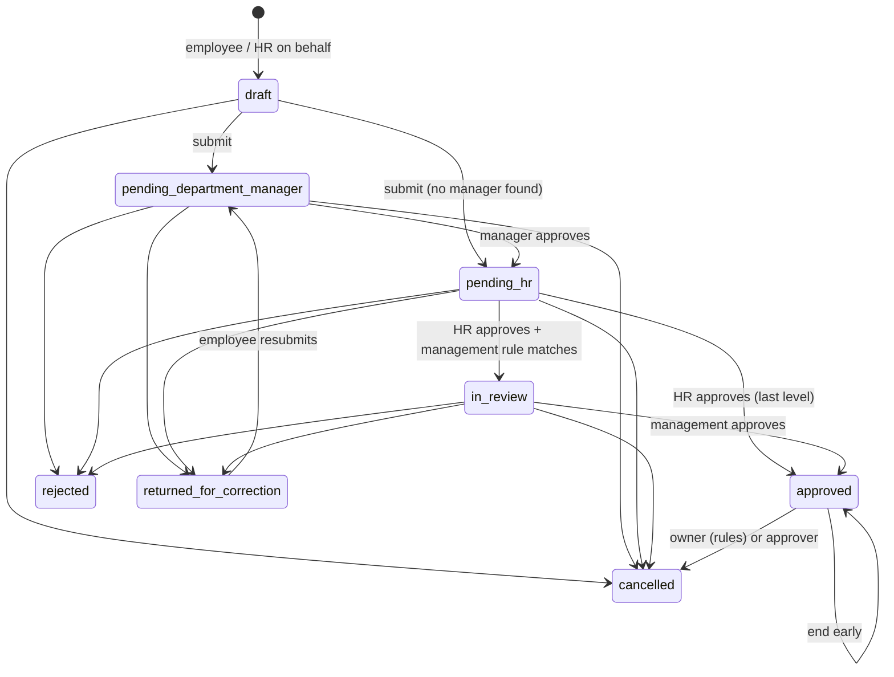

# Leave module: full flow by user type

What the code does today. There is one leave system for every employee (the separate Mainland Tanzania engine was removed on 2026-11-16). Paths: BE = `backend/src`, FE = `frontend/src`. Last reviewed 2026-11-17.

## 1. User types and what they can do

| User type | Seeded role | Scope | Leave permissions (summary) |
| --- | --- | --- | --- |
| Employee | `EMPLOYEE` | self | Apply, view own requests/balances/holidays/policies, cancel own (`leave_requests:read/create/cancel`, `leave_balances:read`, `leave-balances.view-own`) |
| Line manager | `DEPARTMENT_MANAGER`, `BRANCH_MANAGER` | department / branch (+ reports-to tree) | Everything an employee has, plus approve team leave (`leave_requests:approve`), view team balances, team calendar, out-of-office delegation |
| HR officer | `HR_OFFICER` | company | Approve at HR stage, update requests, manage/adjust/export/import balances; read types, policies, workflows, holidays |
| HR manager | `HR_MANAGER` | company | All leave permissions incl. types, policies, workflows, holidays, every balance action |
| Leave admin | `LEAVE_ADMIN` | company | Types/policies/workflows (no delete), balance adjust, import/export, approve/update/cancel requests; no holidays, cannot create requests |
| Finance | `FINANCE` | — | Employee self-service only for leave; leave money reaches them through payroll inputs and final settlements |
| Auditor | `AUDITOR` | company | Read-only + import history |
| Company admin | `COMPANY_ADMIN` | company | Everything |

Seeds: BE `database/seeds/005-company-roles.seed.ts`; permissions: `001-permissions.seed.ts`. Manager visibility comes from `HrAccessService` (BE `modules/hr/shared/hr-access.service.ts`), but **who approves** is decided by the workflow routing (section 3), not by visibility.

## 2. Employee flow

Screen: **My leave** — `/dashboard/me/leave/requests | balances | holidays | policies`. API: `/me/leave/*`.

1. **Check balance** — balances and accrual projection (`GET me/leave/balances`, `…/projection`).
2. **Apply** — choose type and dates, add reason; optional attachment and medical detail. The request is created as **draft** and, on submit, days are **reserved** from the balance, the approval route is built, attendance is recalculated for those dates, and approvers are notified. Must be an active employee; dates cannot be after an exit date.
3. **Save as draft / edit** — drafts (and returned requests) can be edited, then submitted.
4. **Track** — the request shows its stage (manager → HR → management if a rule applies) and each approver's decision.
5. **Returned for correction** — reserved days are released; the employee edits and **resubmits** (new approval cycle).
6. **Cancel** — before approval: anytime, days released. After approval: only if the leave hasn't started, the policy doesn't require approval to cancel, and the cancellation cutoff hasn't passed; used days are restored.
7. **Come back early** — "end early" on approved leave shortens it and restores unused days.
8. **Download PDF** of the request.
9. **Encashment** — "Encash leave" card under My leave → Balances: request, track, cancel.
10. **Verify a PDF** — each request PDF carries a QR code that opens a public verification page (`/verify/leave/<token>`); HR can revoke a code.

## 3. Approval flow (managers, HR, management)

**Who is the approver at each level** (BE `leave/services/leave-workflow.service.ts`):

| Level | Status | Approver |
| --- | --- | --- |
| 1 | `pending_department_manager` | Manager of the employee's primary department → if the employee *is* that manager, their own `reports_to` → if no department manager, `reports_to` → if nobody, skip straight to HR |
| 2 | `pending_hr` | Step 2 of the leave workflow (by role, position or named user). The workflow must have exactly 2 steps; step 1 is not used for routing |
| 3 | `in_review` | Only when an active management approval rule matches |

- Out-of-office delegations replace the approver; the applicant can never approve their own leave.
- Only a user with a pending approval at the current level can act; the other approvers at that level are marked skipped.
- Actions: **approve**, **reject** (comment required), **return for correction**; bulk approve from the list.
- Notifications (in-app + email): submitted, approval required, forwarded, approved, rejected, returned, cancelled, reminders.

**Manager screens:** Leave requests (`/dashboard/leave-management/requests`), action inbox, team calendar, team balances.

**HR-only levers:** set evidence deadline, retry routing (when no approver could be found), cancel any open or approved request, end leave early, create a request on behalf of an employee, bulk-import requests.

## 4. Automatic steps (scheduled jobs)

| Time | Job | Effect |
| --- | --- | --- |
| 01:00 daily (+ on startup) | Balance generation | Recalculates current-year balances for every company |
| 01:30 | Carry-forward | Carry-forward history and expiry of carried days (year-end lapse is recorded only by posted rollover runs, §9.4) |
| 01:45 | Rollover scheduler | Prepares (or, when every policy is automatic, posts) rollover runs for ended leave years |
| Every 30 min | Encashment payment sync | Marks encashments PAID / REVERSED from payroll results (§9.5) |
| 07:30 | Auto-approval | Approves requests pending longer than the leave type's `auto_approve_after_days` |
| 08:00 | Approval reminders | Reminds approvers, escalates to their managers / HR, flags overdue to HR |
| Hourly | Evidence follow-up | Chases requests needing routing and overdue documents |
| Every 10 min | Import watchdog | Fails interrupted balance imports |

## 5. HR administration

Screens under `/dashboard/leave-management/…`:

| Screen | What HR does |
| --- | --- |
| Types | Leave types (paid/unpaid, documents, auto-approval, etc.) |
| Policies | Accrual, holidays/rest-day counting, carry-forward, maximum accumulation, encashment, cancellation rules |
| Workflows | Approval workflow (HR step), management approval rules, HR delegations |
| Holidays | Public holidays (shared with attendance) |
| Balances / Transactions | View, generate, adjust (with reason), reconciliation with opening reviews, exit settlements, manual carry-forward run |
| Balance import | Template export, preview, confirm, history |
| Reports | Leave report downloads; leave encashments (approve/reject, send to payroll, record payment) |

Every backend feature now has a screen.

## 6. Finance / payroll and other modules

- **Payroll run:** reads approved leave for the period; unpaid and partial-pay days become a "Leave without pay" deduction.
- **Encashment while employed:** an approved encashment is handed to payroll by HR as a draft `LEAVE_ENCASHMENT` payroll input; payroll approves it. The handoff is refused unless the company has an active `LEAVE_ENCASHMENT` payroll component (seeded by `038-payroll-baseline` and migration `1797900023000` as a 100% taxable, non-pensionable one-time earning). HR records the payment by hand.
- **Exit:** offboarding creates leave settlement items for paid types with encashment enabled. Final settlement is approved and paid in payroll, which marks the leave exit settlement paid. When offboarding completes, future leave is closed.
- **Attendance:** every submit, approval, cancel and early return recalculates attendance for those dates; approved leave shows on daily attendance.

## 7. Balance rules

- **Available balance** = opening/carried + accrued + adjustments − used − pending − approved future − expired − attendance deductions (`calculateAvailableLeaveDays`). Requests reserve against the ledger's entitlement-based figure, which can differ under monthly accrual.
- **Carry-forward** — leave type or policy-type rules: on/off, a maximum number of days, expiry after months or on a date, and whether carried days are used first.
- **Maximum accumulation** (`maximum_accumulation_days`, policy-type value first, then the policy; empty or 0 = no cap) — enforced since 2026-11-17:
  - accrued days for the year never exceed the cap;
  - at year end, carried days are limited to cap − this year's entitlement (never below 0), on top of the carry-forward cap. The excess is recorded as `LAPSED` in the balance history, so nothing disappears silently.
  - The balance import still only warns, so HR can deliberately set a balance above the cap.
  - Balances are recalculated daily, so setting a cap on an existing policy also reduces the current year's carried days on the next run.

## 8. Gaps found while mapping — fixed 2026-11-14 (rows 3–4 referred to the removed Mainland page)

| # | Gap | Fix |
| --- | --- | --- |
| 1 | Cancel hidden on approved leave and for approvers | Cancel shows for the owner, approvers (`leave_requests:approve`) and company admins; the backend still enforces start-date and cutoff rules |
| 2 | Frontend ignored permission aliases | `dashboard-permissions.ts` mirrors the backend aliases (`leave_balances:read/adjust` satisfy `leave-balances.*`) |
| 3 | Mainland page visible to users who then got 403s | Page gate is `leave-balances.view` or `leave_policies:read`; each section is shown only to users its API accepts |
| 4 | Mainland preview and life events required an unseeded permission | Now `leave_requests:create` |
| 5 | Reports page gate didn't match the API | Gate uses the same permission set as `leave-reports.controller` |
| 6 | Encashment half built | Employee "Encash leave" card under My leave → Balances (request, track, cancel); approver Approve/Reject and HR "Record payment" in Reports → Leave encashments; employee encashment endpoints now permission-guarded. Also fixed: "Send to payroll" never appeared because missing values read as "-" |
| 7 | No screens for exit settlements, opening reviews, carry-forward | Balances tab: exit settlements list + calculate, carry-forward run; reconciliation dialog: "Record review" per balance |
| 8 | Employees shown the delegation panel | Panel uses the shared permission matcher and stays hidden for non-approvers |
| 9 | No HR override at the manager stage | `hr_override` on the approval action: needs `leave_requests:override` (HR manager, HR officer, leave admin, company admin; migration `1797900019000`), a reason, and works only at level 1. It is recorded as its own approval row ("[HR override] …"), the manager rows are skipped, and an audit entry is written. UI: "Approve / Reject for manager" on the request details |
| 10 | Workflow editor allowed levels routing can't use | API and editor accept only level 1 (department manager, auto-filled) and level 2 (HR); a third approval uses management approval rules |
| 11 | Two exit paths could disagree or pay twice | When offboarding has a leave encashment item for the same type, the leave exit settlement is marked `final_settlement` (a record of days, not a payroll instruction) and becomes `paid` when the final settlement is paid |
| 12 | Inconsistent end-early / cancel checks | Service checks use the alias-aware `hasPermission`; the guard keeps `leave_requests:cancel` so employees can end their own leave early |

## 9. Leave policy engine (built 2026-11-17)

One engine for every employee. Three layers, resolved together for an employee, leave type and date:

1. **Statutory rules** (`leave_statutory_rule_sets` / `leave_statutory_rules`, `LeaveStatutoryService`) per jurisdiction. Floors and protections that company policy may add to but never go below.
2. **Company policy versions** (`leave_policies`, matched by branch, department, position, grade, employment type, confirmation status and priority, as before).
3. **Employee evaluation**: the policy version effective on the date, the statutory rule set for the employee's jurisdiction, and the employee's leave cycle.

### 9.1 Notice override and request preview (phase A)
- `POST /leave/requests/preview` and `POST /me/leave/requests/preview` dry-run a request: working days, weekly offs, public holidays, chargeable days, the document rule, notice, the bookable balance and statutory family-leave checks. Both request forms show this server breakdown.
- **One available-balance formula** (`calculateAvailableLeaveDays`). Callers plug in the accrual date: today (screens), the leave's last day (booking under accrual policies), or the full year (the ledger's reservation ceiling). Balance history now records the "available now" figure.
- **Notice period:**
  - Employees can never override their own notice.
  - HR recording leave that has already started needs no notice.
  - Future leave filed on someone's behalf inside the notice period needs `leave_requests:override` and a reason. The override is stamped on the request (`notice_override_*`), audited as `leave_request.notice_overridden`, and shown on request details.

### 9.2 Policy versions (phase B)
- Every policy has a lineage (`policy_key`) and versions (`version_no`). Statuses: `draft` → `pending_approval` → `active` → `superseded` / `archived`. Each version has `effective_from` and `effective_to`.
- Changing an active policy (PATCH, or `POST /leave/policies/:id/versions`) creates a new version.
  - Users with `leave_policies:approve` activate it straight away (today or `effective_from`).
  - Others submit it for approval.
  - The previous version ends the day before. A later-dated version that never took effect is archived.
- **Back-dating** needs `allow_retroactive` and a reason.
- Other endpoints: `/versions`, `/submit`, `/approve`, `/return`, `/discard`, `/compare/:otherId`, `/impact`.
  - Impact lists affected employees: current vs proposed entitlement, current balance, days above a lower accumulation cap, and statutory conflicts.
- Balances use the version effective on the date. Rollover uses the version effective on the last day of the year being closed.
- **Screen:** Policies → "Policy versions and approvals". The editor also covers effective date, reason and draft.

### 9.3 Leave-year cycles (phase C)
- Policy `leave_year_type`: `calendar` (Jan–Dec), `anniversary` (from the hire date) or `custom` (`leave_year_start_month` / `day`).
  - The balance `fiscal_year` is the year the cycle starts in. `leave_year_start_date` and `leave_year_end_date` hold the real bounds.
  - Leap days are clamped, so a 29 Feb start uses 28 Feb.
- Cycle bounds are used by:
  - accrual (daily and monthly);
  - used/pending and attendance-deduction windows;
  - the request date → balance-year mapping (`balanceYearMapper`);
  - the ledger's per-year day split;
  - the projection endpoint;
  - nightly generation (each employee gets the cycle containing today);
  - rollover.
- **Existing balances:** all existing policies stay `calendar`, so nothing changes until HR switches a policy. Switching does not convert history. Balances for the old calendar years stay as they are. Close the last calendar year with a rollover run before changing the cycle.

### 9.4 Carry-forward, lapse and rollover (phase D)
- **Per leave type in a policy:**
  - `carry_forward_method`: all / limited / percentage, plus `carry_forward_percentage`;
  - `lapse_enabled`;
  - `protected_minimum_days`;
  - `auto_encash_enabled`, with method, max days and percentage;
  - `encashment_salary_basis`: basic or gross.
- **Per policy:** `rollover_execution_mode`: `manual_approval` (default) or `automatic`.
- **Calculation order** (`splitUnusedDays`):
  1. Unused days at year end (with full-year accrual).
  2. Carry forward: carry rules, then the maximum-accumulation cap.
  3. Automatic encashment of what is left (priced from salary ÷ divisor; days that can't be priced are retained).
  4. Lapse.
     - Days that are not lapsed are retained on the new year (`retained_days`): protected days (policy or statutory), all days when lapse is off, and annual leave with no active statutory annual rule (legal treatment unverified).
     - The four parts always add up to the unused days.
- **Runs** (`leave_rollover_runs` / `leave_rollover_lines`):
  - Statuses: draft → previewed → pending_approval → processing → completed / partially_failed / failed, or cancelled. Only one open run is allowed per company, year and scope.
  - Lines with blocking exceptions (e.g. leave in that year still awaiting approval) are skipped and their year stays open.
  - Posting runs one transaction per line and is idempotent (keys `rollover:<run>:<line>:*`), so a failed run can be retried.
  - Posting:
    - records the encashment (`ENCASHMENT`) and `LAPSED` on the closed year;
    - sets `closed_at` on the closed year;
    - opens the new year with `carry_forward_locked_days` and `retained_days`;
    - records `CARRY_FORWARD`;
    - creates approved encashment requests (`source = rollover`) for HR to send to payroll.
- **Closed years are frozen:** recalculation skips them and new reservations are refused. Corrections go through adjustments.
- **The nightly 01:30 job no longer records year-end lapse;** only posted runs do. It still syncs carry-forward history and expires carried days.
- **Daily 01:45 job:**
  - when every policy in effect is automatic, it previews and posts years that have ended;
  - otherwise it prepares a preview for HR.
- **Report:** `GET /leave/rollover/runs/:id/report.csv`.
- **Screen:** Leave Management → Year-end Rollover.

### 9.5 Encashment ↔ payroll (phase E)
- **On approval**, the amount is calculated (`LeaveEncashmentCalculatorService`): effective compensation version (basic, or gross = basic + non-excluded component overrides) ÷ the policy's `encashment_rate_divisor` × days. Nothing is guessed: a missing divisor or salary is reported.
- **Handoff:**
  - uses the calculated amount;
  - any other amount needs `leave_encashment:override_amount` and a reason, and is audited;
  - creates a DRAFT payroll input (`leave-encashment:<id>`) and sets the status to `IN_PAYROLL`.
- **Payment status:**
  - `LeaveEncashmentPaymentSyncService` (every 30 min, or `POST /leave/encashments/sync-payments`) sets `PAID` only when the payslip line carrying it is in a payroll run that is `PAID` or `CLOSED`, or its result is `PAID`;
  - `REVERSED` when payroll reverses it;
  - no payroll code was changed.
  - "Record payment outside payroll" stays available and is marked `payment_confirmed_via = manual`.
- **Reverse** (`POST /leave/encashments/:id/reverse`): only when unpaid. It rejects a still-draft payroll input, returns the days (`CANCELLED_REVERSAL`) and is audited.
- **Finance gate:**
  - payroll handoffs are refused until the component is ACTIVE and `calculation_configuration.finance_verified = true` (a `test_configuration` flag is accepted outside production only);
  - Finance confirms the GL, liability and expense accounts, tax treatment, taxable %, pensionable (NSSF), effective date and notes via `POST /leave/payroll-components/confirm` (`leave_encashment:finance_confirm`);
  - **Screen:** Leave Payroll.

### 9.6 Statutory rules (phase F)
- **Rule types:**
  - `annual_leave`: minimum days per cycle, eligibility, protected unused days;
  - `sick_leave`: reference period and ordered pay stages;
  - `maternity_leave`;
  - `paternity_leave`: days, within N days of birth;
  - `public_holiday`: premium % and monthly hours divisor;
  - `termination_settlement`: pay unused annual leave, include carried days, divisor.
- **Lifecycle:** draft → submitted → **legal verification recorded** (sources and notes, `leave_statutory:approve`) → activated with an effective date (the previous set ends the day before).
  - Test configurations can be activated without verification outside production only, and never apply in production.
- **Jurisdiction:** the branch's `statutory_jurisdiction_code`, else the company default (`leave_statutory_company_settings`).
- **Engine effects:**
  - annual entitlement = max(policy quota, statutory minimum);
  - protected days in rollover;
  - maternity/paternity limits block submission (with `event_date` = date of birth);
  - sick-leave pay bands are stored on the request at submission (`pay_breakdown`) for payroll;
  - public-holiday work pay is calculated from attendance and posted as draft `PUBLIC_HOLIDAY_WORK` inputs (Finance gate applies);
  - offboarding pays unused annual leave under an active termination rule even when the policy doesn't encash, and uses its divisor when the policy has none.
- **Templates:** `npm run seed:leave-statutory-templates` creates per company:
  - a **draft, unverified** Tanzania Mainland template (candidate ELRA 2004 values, every one marked "TO VERIFY");
  - an **empty** Zanzibar draft.
  - With `LEAVE_STATUTORY_TEST_ACTIVATE=true` (non-production only) it also activates a `TZ-TEST` copy labelled "TEST ONLY" for end-to-end testing.
- **Screen:** Leave Management → Statutory Rules.

### 9.7 Permissions (migrations 25000, 27000; seeds 001/005)

| Permission | Granted to |
| --- | --- |
| `leave_policies:approve` | COMPANY_ADMIN, HR_MANAGER |
| `leave_rollover:read` | COMPANY_ADMIN, HR_MANAGER, HR_OFFICER, LEAVE_ADMIN, AUDITOR, FINANCE |
| `leave_rollover:manage` | COMPANY_ADMIN, HR_MANAGER, HR_OFFICER, LEAVE_ADMIN |
| `leave_rollover:approve` | COMPANY_ADMIN, HR_MANAGER |
| `leave_statutory:read` | COMPANY_ADMIN, HR_MANAGER, HR_OFFICER, LEAVE_ADMIN, AUDITOR |
| `leave_statutory:manage` / `:approve` | COMPANY_ADMIN, HR_MANAGER |
| `leave_encashment:override_amount` | COMPANY_ADMIN, HR_MANAGER |
| `leave_encashment:finance_confirm` | COMPANY_ADMIN, FINANCE |

### 9.8 Migrations

| Migration | Content |
| --- | --- |
| `1797900023000` | LEAVE_ENCASHMENT component for companies with payroll |
| `1797900024000` | Notice-override columns on leave requests |
| `1797900025000` | Policy versioning, leave-year cycle columns, new permissions |
| `1797900026000` | Rollover settings, runs, lines, balance close/lock/retained columns |
| `1797900027000` | Encashment calculation/payment-sync columns, payment status values, Finance gate flags, permissions |
| `1797900028000` | Statutory rule tables, branch jurisdiction, request `event_date` / `pay_breakdown`, `PUBLIC_HOLIDAY_WORK` component (inactive, unconfirmed) |

All are additive, and the down migrations remove only what they added.

## 10. Still open

| # | Item | Needed from |
| --- | --- | --- |
| 1 | Statutory values for Tanzania Mainland (template entered, unverified) and Zanzibar (empty) must be verified against current legislation, then activated | HR / legal |
| 2 | LEAVE_ENCASHMENT and PUBLIC_HOLIDAY_WORK GL accounts, tax treatment and NSSF treatment must be confirmed | Finance |
| 3 | Payroll does not yet apply `pay_breakdown` (sick-leave partial pay) when calculating unpaid leave; the bands are stored for it | Payroll workstream |
| 4 | Switching a policy from calendar to anniversary/custom years does not convert past balances; close the calendar year by rollover first | HR procedure |
| 5 | Rollover auto-posting is company-wide (all policies must opt in) rather than per policy | Accepted limitation |
| 6 | HR-filed leave that has already started skips notice (by design) | — |
