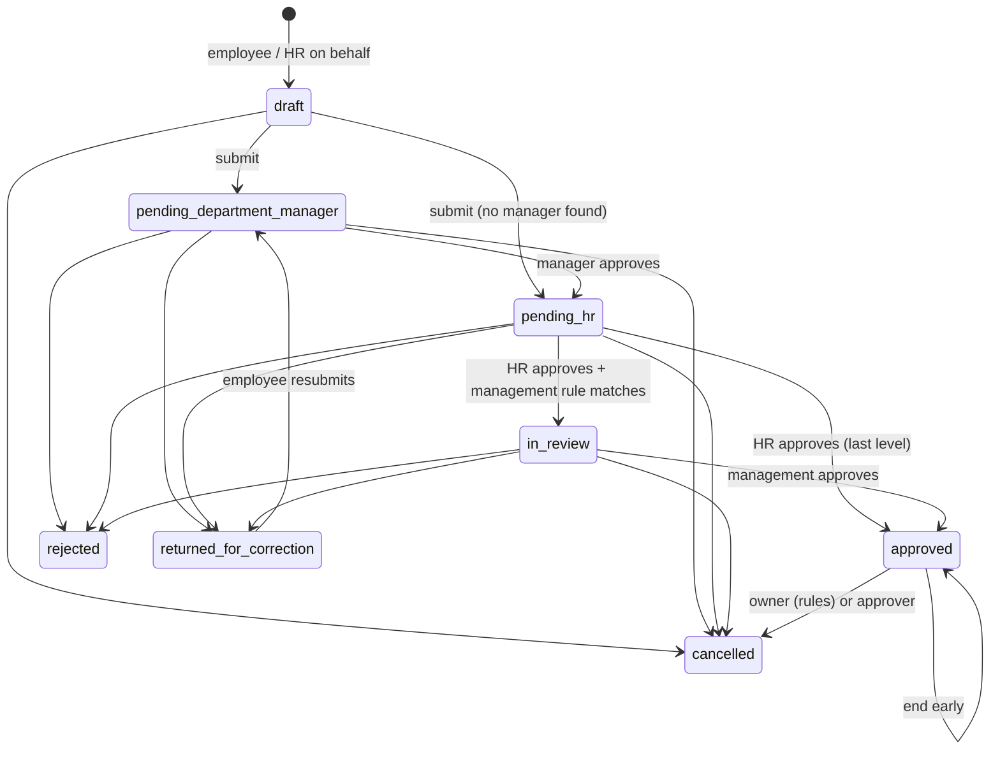

# Leave module: full flow by user type

What the code does today (legacy flow), plus where the not-yet-enabled Mainland Tanzania rules plug in. Paths: BE = `backend/src`, FE = `frontend/src`. Mainland details: [mainland-leave-README.md](mainland-leave-README.md).

## 1. User types and what they can do

| User type | Seeded role | Scope | Leave permissions (summary) |
| --- | --- | --- | --- |
| Employee | `EMPLOYEE` | self | Apply, view own requests/balances/holidays/policies, cancel own (`leave_requests:read/create/cancel`, `leave_balances:read`, `leave-balances.view-own`) |
| Line manager | `DEPARTMENT_MANAGER`, `BRANCH_MANAGER` | department / branch (+ reports-to tree) | Everything an employee has, plus approve team leave (`leave_requests:approve`), view team balances, team calendar, out-of-office delegation |
| HR officer | `HR_OFFICER` | company | Approve at HR stage, update requests, manage/adjust/export/import balances; read types, policies, workflows, holidays |
| HR manager | `HR_MANAGER` | company | All leave permissions incl. types, policies, workflows, holidays, every balance action |
| Leave admin | `LEAVE_ADMIN` | company | Types/policies/workflows (no delete), balance adjust, import/export, approve/update/cancel requests; no holidays, cannot create requests |
| Finance | `FINANCE` | — | Employee self-service only for leave; leave money reaches them through payroll inputs and final settlements |
| Auditor | `AUDITOR` | company | Read-only + import history |
| Company admin | `COMPANY_ADMIN` | company | Everything |

Seeds: BE `database/seeds/005-company-roles.seed.ts`; permissions: `001-permissions.seed.ts`. Manager visibility comes from `HrAccessService` (BE `modules/hr/shared/hr-access.service.ts`), but **who approves** is decided by the workflow routing (section 3), not by visibility.

## 2. Employee flow

Screen: **My leave** — `/dashboard/me/leave/requests | balances | holidays | policies`. API: `/me/leave/*`.

1. **Check balance** — balances and accrual projection (`GET me/leave/balances`, `…/projection`).
2. **Apply** — choose type and dates, add reason; optional attachment and medical detail. The request is created as **draft** and, on submit, days are **reserved** from the balance, the approval route is built, attendance is recalculated for those dates, and approvers are notified. Must be an active employee; dates cannot be after an exit date.
3. **Save as draft / edit** — drafts (and returned requests) can be edited, then submitted.
4. **Track** — the request shows its stage (manager → HR → management if a rule applies) and each approver's decision.
5. **Returned for correction** — reserved days are released; the employee edits and **resubmits** (new approval cycle).
6. **Cancel** — before approval: anytime, days released. After approval: only if the leave hasn't started, the policy doesn't require approval to cancel, and the cancellation cutoff hasn't passed; used days are restored.
7. **Come back early** — "end early" on approved leave shortens it and restores unused days.
8. **Download PDF** of the request.
9. **Encashment** — backend exists (request, list, cancel) but **there is no employee screen yet**.

## 3. Approval flow (managers, HR, management)

**Who is the approver at each level** (BE `leave/services/leave-workflow.service.ts`):

| Level | Status | Approver |
| --- | --- | --- |
| 1 | `pending_department_manager` | Manager of the employee's primary department → if the employee *is* that manager, their own `reports_to` → if no department manager, `reports_to` → if nobody, skip straight to HR |
| 2 | `pending_hr` | Step 2 of the leave workflow (by role, position or named user). The workflow must have exactly 2 steps; step 1 is not used for routing |
| 3 | `in_review` | Only when an active management approval rule matches |

- Out-of-office delegations replace the approver; the applicant can never approve their own leave.
- Only a user with a pending approval at the current level can act; the other approvers at that level are marked skipped.
- Actions: **approve**, **reject** (comment required), **return for correction**; bulk approve from the list.
- Notifications (in-app + email): submitted, approval required, forwarded, approved, rejected, returned, cancelled, reminders.

**Manager screens:** Leave requests (`/dashboard/leave-management/requests`), action inbox, team calendar, team balances.

**HR-only levers:** set evidence deadline, retry routing (when no approver could be found), cancel any open or approved request, end leave early, create a request on behalf of an employee, bulk-import requests.

## 4. Automatic steps (scheduled jobs)

| Time | Job | Effect |
| --- | --- | --- |
| 01:00 daily (+ on startup) | Balance generation | Recalculates current-year balances for every company |
| 01:15 Dar es Salaam | Mainland cycle job | Only for employees assigned to Mainland (none until enablement) |
| 01:30 | Carry-forward | Carry-forward, expiry and year-end lapse per balance |
| 07:30 | Auto-approval | Approves requests pending longer than the leave type's `auto_approve_after_days` |
| 08:00 | Approval reminders | Reminds approvers, escalates to their managers / HR, flags overdue to HR |
| Hourly | Evidence follow-up | Chases requests needing routing and overdue documents |
| Every 10 min | Import watchdog | Fails interrupted balance imports |

## 5. HR administration

Screens under `/dashboard/leave-management/…`:

| Screen | What HR does |
| --- | --- |
| Types | Leave types (paid/unpaid, documents, auto-approval, etc.) |
| Policies | Accrual, holidays/rest-day counting, carry-forward, encashment, cancellation rules; policy drafts |
| Workflows | Approval workflow (HR step), management approval rules, HR delegations |
| Holidays | Public holidays (shared with attendance) |
| Balances / Transactions | View, generate, adjust (with reason), carry-forward, reconciliation |
| Balance import | Template export, preview, confirm, history |
| Reports | Leave reports downloads |
| Mainland | Profiles, policy revisions, cutover, balances, reports, operations — **for the new Tanzania rules, not active yet** |

Backend-only (no screen yet): exit settlements, opening-preview reviews, manual carry-forward run, encashment approval decision and payment.

## 6. Finance / payroll and other modules

- **Payroll run:** reads approved leave for the period; unpaid and partial-pay days become a "Leave without pay" deduction. For Mainland employees, each day uses its own pay rate (e.g. half-pay sick), unapproved absence is deducted, and public-holiday work is paid as its own line.
- **Encashment while employed:** an approved encashment is handed to payroll by HR as a draft `LEAVE_ENCASHMENT` payroll input.
- **Exit:** offboarding creates leave settlement items (legacy: paid types with encashment enabled; Mainland: annual leave only at monthly basic ÷ 26). Final settlement is approved and paid in payroll; for Mainland the payout is then recorded on the leave ledger. When offboarding completes, future leave is closed.
- **Attendance:** every submit, approval, cancel and early return recalculates attendance for those dates; approved leave shows on daily attendance. Mainland adds a block on clock-in within 6 weeks of a birth unless HR records a fitness-certificate override.

## 7. Where the Mainland rules plug in

Nothing changes for an employee until HR posts a signed cutover and assigns them. After that, the same screens and approval flow are used; only the balance and the rules behind them change:

- On submit, the Mainland rules replace the legacy entitlement check (`LeaveService.isMainlandRequest`), and the new ledger takes the reservation (`LeaveBalanceLedgerService.routeMainland`). Approve, cancel and early return go to the same ledger.
- A request crossing the employee's Mainland start date is rejected and must be split.
- Employees and HR can preview a request against the Mainland rules (`POST /api/leave/mainland/preview`).

## 8. Gaps found while mapping — fixed 2026-11-14

| # | Gap | Fix |
| --- | --- | --- |
| 1 | Cancel hidden on approved leave and for approvers | Cancel shows for the owner, approvers (`leave_requests:approve`) and company admins; the backend still enforces start-date and cutoff rules |
| 2 | Frontend ignored permission aliases | `dashboard-permissions.ts` mirrors the backend aliases (`leave_balances:read/adjust` satisfy `leave-balances.*`) |
| 3 | Mainland page visible to users who then got 403s | Page gate is `leave-balances.view` or `leave_policies:read`; each section is shown only to users its API accepts |
| 4 | Mainland preview and life events required an unseeded permission | Now `leave_requests:create` |
| 5 | Reports page gate didn't match the API | Gate uses the same permission set as `leave-reports.controller` |
| 6 | Encashment half built | Employee "Encash leave" card under My leave → Balances (request, track, cancel); approver Approve/Reject and HR "Record payment" in Reports → Leave encashments; employee encashment endpoints now permission-guarded. Also fixed: "Send to payroll" never appeared because missing values read as "-" |
| 7 | No screens for exit settlements, opening reviews, carry-forward | Balances tab: exit settlements list + calculate, carry-forward run; reconciliation dialog: "Record review" per balance |
| 8 | Employees shown the delegation panel | Panel uses the shared permission matcher and stays hidden for non-approvers |
| 9 | No HR override at the manager stage | `hr_override` on the approval action: needs `leave_requests:override` (HR manager, HR officer, leave admin, company admin; migration `1797900019000`), a reason, and works only at level 1. It is recorded as its own approval row ("[HR override] …"), the manager rows are skipped, and an audit entry is written. UI: "Approve / Reject for manager" on the request details |
| 10 | Workflow editor allowed levels routing can't use | API and editor accept only level 1 (department manager, auto-filled) and level 2 (HR); a third approval uses management approval rules |
| 11 | Two exit paths could disagree or pay twice | When offboarding has a leave encashment item for the same type, the leave exit settlement is marked `final_settlement` (a record of days, not a payroll instruction) and becomes `paid` when the final settlement is paid |
| 12 | Inconsistent end-early / cancel checks | Service checks use the alias-aware `hasPermission`; the guard keeps `leave_requests:cancel` so employees can end their own leave early |
